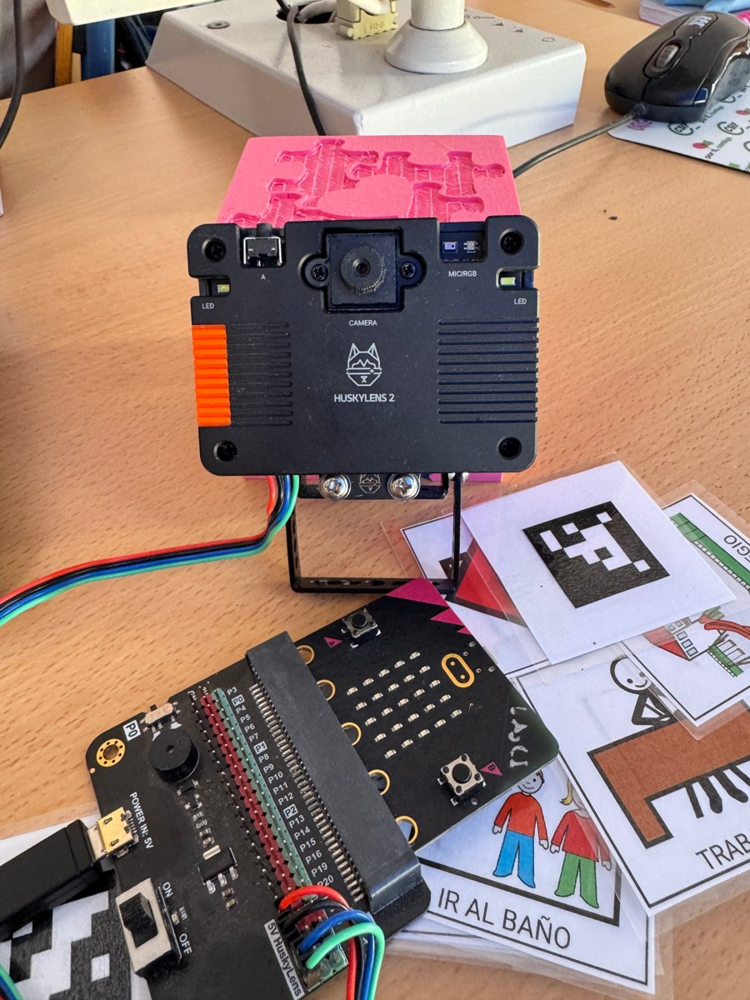
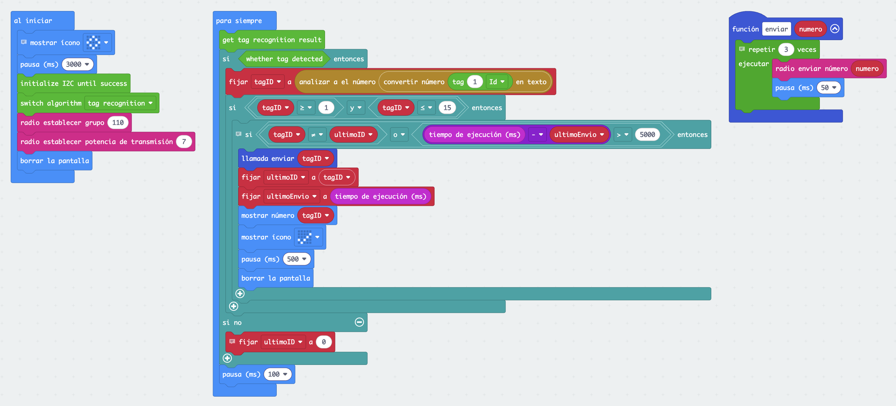
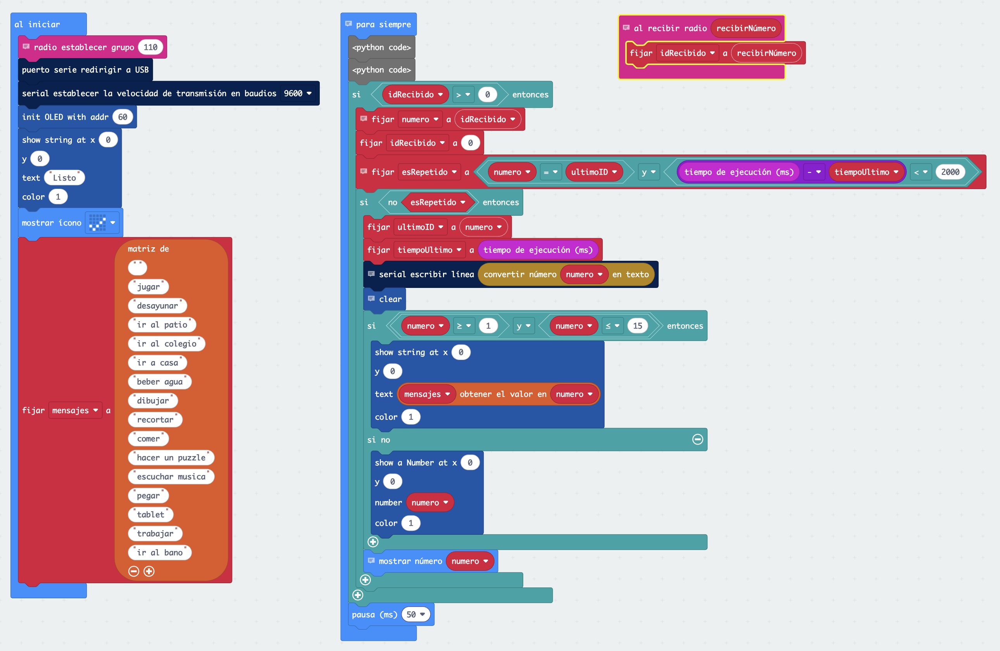

# Picto:Bit · Comunicador esencial

**Un alumno enseña un pictograma a una cámara y su maestro lo ve a pantalla completa y lo oye, esté donde esté del aula.**

Picto:Bit es un comunicador con pictogramas pensado para alumnado con autismo (TEA) o con dificultades de comunicación oral. Está construido con dos micro:bit, una cámara con inteligencia artificial (HuskyLens) y un portátil.

Proyecto del **CEIP General Fresneda** (Jódar, Jaén), presentado en **SIMO Educación 2026**.



## Cómo funciona

```
Tarjeta ──► HuskyLens ──► micro:bit emisora ──radio──► micro:bit receptora ──USB──► Portátil
            (lee la       (la lleva el                  (escribe la palabra         (pictograma a
             etiqueta)     alumno)                       en su pantalla OLED)        pantalla completa
                                                                                     + audio)
```

Por el aire solo viaja un número del 1 al 15. Cada pieza lo convierte en algo que una persona entiende.

## Qué hay en este repositorio

| Carpeta | Contenido |
| --- | --- |
| [`makecode/`](makecode) | Código de la micro:bit emisora y de la receptora (MakeCode, vista Python) |
| [`pc/`](pc) | Programa del portátil (`picto_bit.py`), arranque con doble clic, pictogramas e imagen de espera |
| [`pc/snd/`](pc/snd) | Aquí van los audios `1.wav` … `15.wav` |
| [`tarjetas/`](tarjetas) | Cómo preparar las tarjetas con su etiqueta AprilTag |
| [`docs/`](docs) | Fotos del proyecto y capturas de los bloques |

## Material

- 2 micro:bit (V2 recomendada): una emisora y una receptora
- Cámara HuskyLens
- Placa de expansión para micro:bit (con alimentación propia para la cámara)
- Pantalla OLED 128×64 I2C
- Batería o portapilas para la emisora
- Cable USB **de datos** para la receptora
- Portátil con Windows y altavoces
- 15 tarjetas con pictograma y etiqueta AprilTag

## Puesta en marcha

### 1. Conexiones (I2C)

| HuskyLens | Placa | | OLED | Placa |
| --- | --- | --- | --- | --- |
| T (SDA) | P20 | | SDA | P20 |
| R (SCL) | P19 | | SCL | P19 |
| − | GND | | GND | GND |
| + | 3V3 o 5V | | VCC | 3V3 |

### 2. La cámara

1. **Ajustes generales → Protocolo → I2C**.
2. Modo **Reconocimiento de etiquetas**, con **Aprender varios** activado.
3. Enseña las etiquetas **en orden, de la 1 a la 15**: el número de cada tarjeta es el orden en que la aprende.

### 3. Las micro:bit

Abre cada proyecto en MakeCode, pulsa **Editar código** y descárgalo a su placa:

- Emisora: https://makecode.microbit.org/S94147-16441-13294-82944
- Receptora: https://makecode.microbit.org/S22039-08995-60773-61851

También puedes crear un proyecto nuevo, añadir las extensiones (HuskyLens y `oled12864`) y pegar el código de [`makecode/`](makecode) en la vista Python.

| Emisora | Receptora |
| --- | --- |
|  |  |

### 4. El portátil

1. Descarga este repositorio (**Code → Download ZIP**) y descomprímelo, por ejemplo en `C:\pictobit`.
2. Instala Python 3.13 desde [python.org](https://www.python.org/downloads/) y, en una terminal:
   ```
   py install 3.13
   py -3.13 -m pip install -r pc/requirements.txt
   ```
3. Pon tus audios en `pc/snd/` (`1.wav` … `15.wav`).
4. Haz doble clic en `pc/iniciar_pictobit.bat` (o crea un acceso directo en el escritorio).

> Usa Python 3.13: con la versión más reciente, `pygame` aún no se instala en Windows.

## Uso diario

1. Enciende la emisora (rombo durante 3 s mientras arranca la cámara).
2. Conecta la receptora al portátil por USB («Listo» en la OLED).
3. Doble clic en el acceso directo. Pulsa **ESC** para salir.

## Los 15 pictogramas

| Nº | Pictograma | Nº | Pictograma | Nº | Pictograma |
| --- | --- | --- | --- | --- | --- |
| 1 | jugar | 6 | beber agua | 11 | escuchar música |
| 2 | desayunar | 7 | dibujar | 12 | pegar |
| 3 | ir al patio | 8 | recortar | 13 | tablet |
| 4 | ir al colegio | 9 | comer | 14 | trabajar |
| 5 | ir a casa | 10 | hacer un puzzle | 15 | ir al baño |

La lista no es cerrada: son los que más usamos en nuestra clase. Para cambiar uno, sustituye su imagen y su audio, la palabra en la lista `mensajes` de la receptora y en `PICTOGRAMAS` de `picto_bit.py`. Para añadir más de 15, cambia también el límite `15` en la emisora y en la receptora.

## Problemas frecuentes

| Síntoma | Solución |
| --- | --- |
| La emisora no detecta tarjetas | Espera al rombo del arranque; comprueba que la HuskyLens está en I2C |
| Se reinicia o la cámara falla | Falta alimentación: usa una placa de expansión con batería |
| La receptora no recibe | Mismo `radio.set_group(110)` en las dos placas |
| Sale otro pictograma | Las tarjetas se aprendieron en otro orden: olvídalas y apréndelas de la 1 a la 15 |
| «No module named serial» | `py -3.13 -m pip install -r pc/requirements.txt` |
| El portátil no encuentra la micro:bit | Cierra MakeCode y cualquier monitor serie; prueba otro cable USB |
| Sale la palabra en vez de la imagen | Falta el archivo o su nombre no coincide (mira el aviso al arrancar) |

## Marco normativo

Convención de la ONU sobre los derechos de las personas con discapacidad (arts. 2 y 24) · LOMLOE (LO 3/2020) · RD 157/2022 · Decreto 101/2023 y Orden de 30 de mayo de 2023 (Andalucía) · Agenda 2030: ODS 4 (meta 4.5) y ODS 10 (meta 10.2).

## Créditos y licencia

- **Código:** licencia [MIT](LICENSE). Úsalo, adáptalo y compártelo.
- **Pictogramas:** Autor pictográfico: Sergio Palao. Origen: [ARASAAC](https://arasaac.org). Licencia: CC (BY-NC-SA). Propiedad: Gobierno de Aragón (España).
- **Autor del proyecto:** Francisco Javier Carmona del Jesus, CEIP General Fresneda (Jódar, Jaén), con su alumnado.

¿Lo montas en tu aula? Nos encantará saber cómo funciona.
